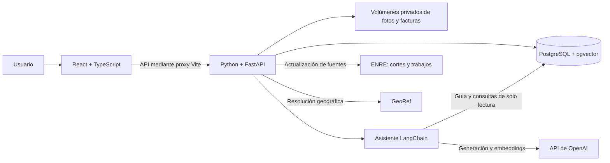

# Energía Sur

Energía Sur es una aplicación web para usuarios del servicio eléctrico de Edesur en la Zona Sur del Gran Buenos Aires. Reúne información pública sobre cortes y trabajos de mantenimiento, y permite llevar un registro personal del servicio y del consumo eléctrico.

Desde una misma aplicación se pueden consultar zonas afectadas, administrar domicilios y medidores, registrar lecturas y facturas, comparar consumos y generar reportes de interrupciones. Un asistente conversacional con inteligencia artificial orienta sobre consultas y trámites, cita fuentes oficiales y comunica las limitaciones de la información disponible.

El proyecto se desarrolla como **Trabajo Práctico Integrador de Arquitectura de Agentes IA**. La documentación conserva los diez casos de uso propuestos, las decisiones posteriores y las evidencias del proceso de desarrollo asistido por IA. Es una aplicación académica independiente de Edesur.

## 1. Stack tecnológico

| Capa | Tecnologías utilizadas |
| --- | --- |
| Frontend | React, TypeScript, Vite, Tailwind CSS, componentes locales shadcn/ui sobre Radix UI, Zustand, React Hook Form, Zod y Axios. |
| Backend | Python 3.13, FastAPI, Uvicorn, Pydantic, SQLAlchemy, psycopg y Alembic; ReportLab para PDF, Pillow/pypdf para archivos y Tesseract/OpenCV para OCR local. |
| Base de datos | PostgreSQL 18 con la extensión pgvector; volúmenes privados para fotos y facturas. |
| Inteligencia artificial | LangChain y OpenAI: generación con `gpt-4o-mini` y embeddings con `text-embedding-3-small` por defecto; recuperación documental (RAG) en pgvector. |
| Infraestructura | Docker y Docker Compose para desarrollo local. El alojamiento definitivo sigue pendiente. |
| Desarrollo asistido por IA | OpenCode como implementador y orquestador; Codex para revisión y depuración; OpenSpec para especificaciones y cambios. |
| Testing y análisis estático | `unittest` de Python, `node:test`, Playwright con Chromium, Ruff, mypy, Oxlint y TypeScript. |

Las versiones y dependencias exactas están en [frontend/package.json](frontend/package.json), [package-lock.json](frontend/package-lock.json), [backend/pyproject.toml](backend/pyproject.toml) y [uv.lock](backend/uv.lock). Las imágenes y herramientas de contenedor están fijadas en los Dockerfile de [frontend](frontend/Dockerfile) y [backend](backend/Dockerfile).

## 2. Puesta en marcha

### Requisitos previos

- Git, PowerShell y Docker Desktop en ejecución con contenedores Linux y Docker Compose.
- Puertos locales `5173` y `8000` disponibles y acceso a Internet para construir imágenes y consultar fuentes externas.
- No se necesitan Node, Python, npm ni uv instalados en Windows para ejecutar la aplicación mediante contenedores.

Los comandos siguientes se ejecutan desde la raíz del repositorio. El backend utiliza funciones de Linux para procesar y proteger archivos; se ejecuta dentro de Docker Desktop.

```powershell
git clone https://github.com/elianAVG00/energia-sur.git
Set-Location energia-sur
if (-not (Test-Path .env)) { Copy-Item .env.example .env }
```

Editá `.env` localmente antes de continuar. El archivo está excluido de Git; [.env.example](.env.example) contiene únicamente una plantilla sin secretos.

| Variable | Necesidad y configuración |
| --- | --- |
| `POSTGRES_PASSWORD` | Obligatoria: contraseña local no vacía para inicializar PostgreSQL. |
| `POSTGRES_DB`, `POSTGRES_USER` | Opcionales; ambos usan `energia_sur` por defecto. |
| `CU09_DATABASE_URL` | Obligatoria para la aplicación completa. Usar `postgresql+psycopg://USUARIO:CONTRASENA_CODIFICADA@db:5432/BASE`, con los datos locales correspondientes y la contraseña codificada para una URL. El overlay la entrega al backend como `DATABASE_URL`. |
| `CU09_APP_ORIGINS` | Opcional: lista explícita de orígenes permitidos; por defecto `http://127.0.0.1:5173,http://localhost:5173`. |
| `CU09_COOKIE_SECURE` | Opcional: `false` para HTTP local; `true` cuando se configure HTTPS. |
| `OPENAI_API_KEY` | Opcional, solo del backend; habilita la generación y los embeddings de OpenAI. |
| `OPENAI_MODEL`, `OPENAI_EMBEDDING_MODEL` | Opcionales; valores predeterminados indicados en el stack. El índice actual utiliza embeddings de 1536 dimensiones. |
| `ASSISTANT_GUIDE_INGEST` | Opcional; `false` por defecto. Permite ingerir la guía al iniciar si se configura en `true`; también existe un comando manual. |

En una base local nueva, la conexión debe corresponder al usuario y la base inicializados por Compose. Ese usuario inicial tiene privilegios administrativos de PostgreSQL; para usar un rol de aplicación separado, provisionar previamente la base y la extensión `vector`, como se explica en la [guía operativa](backend/README.md#operación-local-y-verificaciones).

### Inicio de la aplicación completa

Usá conjuntamente [compose.yaml](compose.yaml) y [compose.cu09.yaml](compose.cu09.yaml). El segundo agrega la conexión del backend a PostgreSQL; el nombre CU09 conserva el origen histórico de esa integración.

```powershell
docker compose -f compose.yaml -f compose.cu09.yaml config --quiet
docker compose -f compose.yaml -f compose.cu09.yaml build
docker compose -f compose.yaml -f compose.cu09.yaml up -d --wait --wait-timeout 90 db
# Preparar el esquema de la base local elegida antes de iniciar la aplicación.
docker compose -f compose.yaml -f compose.cu09.yaml run --rm --no-deps backend alembic upgrade head
docker compose -f compose.yaml -f compose.cu09.yaml up -d --no-deps --wait --wait-timeout 90 backend frontend
docker compose -f compose.yaml -f compose.cu09.yaml ps
```

Esta secuencia está orientada a una instalación local nueva. Si ya hay datos, verificá la base seleccionada y su respaldo antes de aplicar migraciones. Ejecutar solo el archivo base permite comprobar infraestructura, pero no configura la persistencia de la aplicación.

| Servicio | Dirección local |
| --- | --- |
| Aplicación web | <http://127.0.0.1:5173> |
| API y documentación interactiva | <http://127.0.0.1:8000/docs> |
| Comprobación HTTP del backend | <http://127.0.0.1:8000/health> |
| Comprobación a través del proxy del frontend | <http://127.0.0.1:5173/api/health> |

El navegador utiliza `/api` a través de Vite. Los nombres `backend` y `db` pertenecen a la red interna de Compose; PostgreSQL no publica un puerto en Windows. `/health` comprueba disponibilidad HTTP, no la preparación de la base ni de OpenAI.

### Acceso y asistente opcional

En **Mi cuenta**, elegí **Crear cuenta** y luego iniciá sesión. El registro público está implementado y la aceptación sintética integral de registro, domicilio, aislamiento, CSRF, PDFs y persistencia tras reinicio pasó; el cambio sigue activo mientras se completa la revisión final. También se conserva el [alta de cuentas por CLI y la promoción a administrador](backend/README.md#cuentas-y-administración); no existen credenciales predeterminadas.

Sin clave de OpenAI, el resto de la aplicación puede funcionar y el asistente muestra una respuesta estática de contingencia. Para habilitar las respuestas generadas, configurá `OPENAI_API_KEY` en `.env`, recreá el backend y ejecutá una vez la ingesta de la guía:

```powershell
docker compose -f compose.yaml -f compose.cu09.yaml up -d --no-deps backend
docker compose -f compose.yaml -f compose.cu09.yaml exec backend python -m app.ingest_guide
```

La ingesta y las consultas generadas consumen la API de OpenAI. Se utiliza la [guía de Edesur incluida](backend/knowledge/guia-oficial-edesur.md), con fuentes y fecha de verificación; su contenido sujeto a cambios requiere revalidación periódica.

### Detención y reinicio

```powershell
docker compose -f compose.yaml -f compose.cu09.yaml stop
docker compose -f compose.yaml -f compose.cu09.yaml up -d --wait --wait-timeout 90
```

Conservá los volúmenes `pgdata`, `cu05_photos` y `cu06_bills`. Cambiar `.env` no cambia la contraseña de una base ya inicializada. La [guía operativa](backend/README.md#operación-local-y-verificaciones) detalla reinicios, respaldos y verificaciones con datos sintéticos.

## 3. Arquitectura



- **Frontend:** presenta consultas públicas, el espacio privado Mi cuenta, la administración y un único panel del asistente.
- **Backend:** valida solicitudes y permisos, aplica reglas y cálculos, genera reportes y coordina las integraciones externas.
- **PostgreSQL y archivos privados:** conservan cuentas, domicilios, medidores, lecturas, facturas, interrupciones, capturas de ENRE y conversaciones autenticadas; pgvector permite recuperar artículos de la guía.
- **Asistente:** combina recuperación documental y herramientas internas de lectura sobre las capturas de CU01/CU02. Responde por SSE y cita fuentes; no consulta ENRE ni GeoRef durante una pregunta ni modifica registros del usuario.
- **ENRE y GeoRef:** aportan información pública del servicio y resolución de zonas. Las respuestas conservan procedencia, antigüedad e incertidumbre; pertenecer a una localidad no acredita cobertura individual de Edesur.

Las decisiones y contratos se consultan en [OpenSpec](openspec/specs/) y en las bitácoras enlazadas en la sección de documentación.

## 4. Los 10 casos de uso

El [catálogo de casos de uso](docs/use-cases/README.md) conserva las fichas y la propuesta académica. U06 registra la confirmación del usuario de que el docente aprobó los diez CU; no consta fecha ni canal de esa aprobación. Las [especificaciones vigentes](openspec/specs/) y las decisiones posteriores delimitan el comportamiento actual.

| ID | Caso de uso | Descripción breve | Estado real |
| --- | --- | --- | --- |
| CU01 | Consultar cortes actuales en una zona | Búsqueda territorial, por dirección o geolocalización, con procedencia y estado de la fuente. | Implementado y archivado; ampliación territorial activa. |
| CU02 | Consultar trabajos de mantenimiento eléctrico informados por ENRE | Consulta territorial de los trabajos publicados para Edesur, con sus limitaciones. | Implementado y archivado bajo U22; ampliación territorial activa. |
| CU03 | Consultar al asistente integrado | Orientación con guía documental, consultas de cortes/trabajos y fuentes oficiales. | Implementado y archivado; consulta real con OpenAI documentada. |
| CU04 | Gestionar domicilios y medidores | Administración privada del contexto de trabajo de cada cuenta. | Implementado y archivado. |
| CU05 | Registrar una lectura de medidor con foto | Lecturas manuales, fotos privadas y sugerencias OCR sujetas a confirmación. | Implementado y archivado; sin garantía de precisión OCR. |
| CU06 | Registrar una factura de electricidad | Carga y corrección de facturas con archivos privados. | Implementado y archivado. |
| CU07 | Comparar consumo registrado con una factura | Comparación del consumo calculado desde lecturas con el facturado. | Implementado y archivado. |
| CU08 | Ver evolución y estimación de consumo | Evolución por intervalos y estimaciones orientativas desde lecturas. | Implementado y archivado. |
| CU09 | Registrar y consultar un diario de interrupciones | Registro privado de cortes, resúmenes por período y reportes PDF. | Implementado y archivado. |
| CU10 | Supervisar la actualización automática de fuentes | Consulta del estado, reintento y configuración de intervalos por administradores. | Implementado y archivado; E2E real de administrador pendiente. |

**CU02 fue redefinido mediante U22:** la entrega consulta los trabajos informados por ENRE. La agenda futura, los filtros por fecha y los datos no publicados quedaron fuera de alcance. La propuesta original se conserva en la [ficha CU02](docs/use-cases/cu02.md) y la [decisión U22](docs/use-cases/decisions.md#u22---cu02-definitive-scope-redefinition); no hay evidencia de aprobación docente de esta redefinición.

“Implementado y archivado” describe la entrega de cada cambio base. No equivale a una validación integral del árbol actual: siguen pendientes **QA-INT-CU04-08**, otras comprobaciones reales y el cierre de las ampliaciones activas, según [STATE.md](docs/STATE.md).

## 5. AI Engineering

### 5.1 Herramientas y configuración

| Recurso | Función en el proyecto |
| --- | --- |
| OpenCode | Implementación y orquestación del trabajo, con perfiles especializados y permisos definidos por cliente. |
| Codex | Revisión independiente y depuración focalizada, según las instrucciones del proyecto; esta refactorización documental se realiza con Codex. |
| OpenSpec | Especificaciones, propuestas, diseño, tareas y archivo de cambios mediante Spec-Driven Development. |
| [AGENTS.md](AGENTS.md) | Reglas operativas, límites de autorización y criterios de cierre. |
| [opencode.jsonc](opencode.jsonc) | Configuración de los MCP de desarrollo y excepciones de permisos para el agente principal `build`. |
| [Skills locales](.agents/skills/) | `fastapi-endpoint` para contratos HTTP y `quality-gate` para verificación; seis Skills de OpenSpec, también generadas en `.opencode/skills/`. |
| [Comandos OpenSpec](.opencode/commands/) | `opsx-explore`, `opsx-propose`, `opsx-apply`, `opsx-update`, `opsx-sync` y `opsx-archive`. |

Estas instrucciones corresponden al agente de desarrollo. El asistente del producto tiene su propio [prompt y lógica](backend/app/assistant.py), separados de los permisos y herramientas de OpenCode.

### 5.2 Orquestación de agentes

Los cinco perfiles existen en [.opencode/agents/](.opencode/agents/). Son subagentes de OpenCode; su presencia no configura automáticamente subagentes en Codex.

| Agente | Responsabilidad y límite configurado |
| --- | --- |
| `spec-analyst` | Analiza requisitos y devuelve borradores; solo lectura, sin implementar código. |
| `backend` | Implementa contratos y pruebas de Python/FastAPI; edición limitada a `backend/`. |
| `frontend` | Implementa integración y pruebas de React/TypeScript; edición limitada a `frontend/`. |
| `qa` | Contrasta criterios y evidencia, e informa fallos reproducibles; solo lectura. |
| `reviewer` | Revisa arquitectura, seguridad y regresiones de forma independiente; solo lectura, sin aplicar correcciones. |

Los perfiles personalizados deniegan shell, ejecución y nuevas delegaciones. El agente principal ejecuta las comprobaciones permitidas y conserva la evidencia; configurar un rol de QA no demuestra que haya ejecutado pruebas. Las bitácoras identifican las intervenciones reales.

### 5.3 Prompts clave

Los siguientes ejemplos resumen instrucciones conservadas en el repositorio; no son transcripciones inventadas de conversaciones:

| Instrucción verificable | Propósito y resultado documentado |
| --- | --- |
| Contrastar los diez CU con el repositorio y las aprobaciones, identificar contradicciones y no resolver decisiones pendientes por inferencia. | Prompt de `spec-analyst` registrado en la [etapa 05](docs/ai-engineering/stage-05-sdd.md#actual-agents-and-tools): produjo el catálogo, preguntas y límites de autorización. |
| Adoptar como alcance definitivo de CU02 la consulta de trabajos informados por ENRE. | Instrucción FINALIZE registrada en [U22](docs/use-cases/decisions.md#u22---cu02-definitive-scope-redefinition): preservó la propuesta original y eliminó afirmaciones sobre una agenda futura entregada. |
| Mantener Mi cuenta en una página con índice, seis secciones y contratos existentes. | Instrucciones U31/U32 recogidas en la [bitácora de Mi cuenta](docs/ai-engineering/redesign-account-workspace.md#approval-and-instructions): guiaron la reorganización por etapas y la revisión acumulada. |

### 5.4 Metodología e iteraciones

El flujo es **Explore → Propose → Review → Apply → Verify → Archive**. Se investigan alcance y decisiones; se preparan `proposal`, `specs`, `design` y `tasks`; se obtiene aceptación humana; se implementan tareas autorizadas; se verifican resultados; finalmente se sincroniza y archiva cuando corresponde.

Review y Verify son procedimientos del equipo, no comandos `opsx-review` u `opsx-verify` instalados. La validación estructural de OpenSpec no acredita funcionamiento. El [workflow documentado](docs/openspec-workflow.md) explica las transiciones y sus límites.

Entre las iteraciones reales, CU03 incorporó requisitos de incertidumbre, aislamiento de conversaciones y excepciones de transporte tras revisión; CU09 adoptó Oxlint mediante U08 ante la incompatibilidad de la alternativa de lint con TypeScript. Las bitácoras de [CU03](docs/ai-engineering/implement-integrated-assistant-cu03.md) y [CU09](docs/ai-engineering/record-cu09-interruption-diary.md) conservan problemas, decisiones y comprobaciones.

### 5.5 Loops de autocorrección

El proceso combina reproducción, investigación, corrección, pruebas focalizadas y revisión independiente. `quality-gate` exige evidencia y escalamiento tras tres ciclos fallidos del mismo problema. Es un proceso asistido con decisiones humanas y validaciones manuales.

Un ejemplo es el [aislamiento del historial CU05](docs/ai-engineering/isolate-cu05-reading-history-by-meter.md): al cambiar de medidor persistía una lectura anterior. Se identificaron claves duplicadas entre componentes hermanos; al restaurar temporalmente el defecto fallaron cinco pruebas y, con la corrección, pasaron las nueve. La revisión agregó comprobaciones de carreras, reinicio de contexto y advertencias de React. Las regresiones integrales con backend preparado quedaron explícitamente diferidas.

La revisión final de [Mi cuenta](docs/ai-engineering/redesign-account-workspace.md#final-accumulated-review-and-closure-verification-2026-11-15) detectó una regresión en la acción de descarga PDF; se corrigió y volvió a revisar. Estos registros distinguen revisión estática, pruebas con mocks y ejecución real.

## 6. MCP — Model Context Protocol

MCP permite que un cliente de IA descubra y utilice herramientas de servidores externos mediante una interfaz común. Energía Sur lo utiliza en el **entorno de desarrollo**, con dos servidores remotos configurados en [opencode.jsonc](opencode.jsonc).

| Servidor | Tipo y función | Autenticación general | Evidencia de uso |
| --- | --- | --- | --- |
| GitHub | Externo, remoto por HTTP; lectura de archivos de repositorios mediante el endpoint de solo lectura de GitHub. | PAT de alcance mínimo por `ENERGIA_SUR_GITHUB_PAT` en el entorno del proceso de OpenCode. | Lectura real de `README.md` de Energía Sur el 07/11/2026; respuesta y SHA registrados. |
| Context7 | Externo de Upstash, remoto por HTTP; búsqueda de documentación técnica. | OAuth del usuario, fuera de los archivos del proyecto. | Resolución de FastAPI y consulta de validación/errores el 07/11/2026; fuentes y resultados registrados. |

La [bitácora MCP](docs/ai-engineering/configure-readonly-development-mcp.md#live-verification--2026-11-07) conserva descubrimiento, cliente, origen, llamadas y limitaciones. Son pruebas históricas de uso, no una comprobación nueva de conectividad.

Solo `build` tiene excepciones con confirmación para `github_get_file_contents`, `context7_resolve-library-id` y `context7_query-docs`; los demás accesos y el descubrimiento genérico de recursos están denegados. La guía de autenticación y recarga está en esa bitácora.

**El chatbot no consume estos MCP.** CU03 usa herramientas internas LangChain de lectura sobre capturas de CU01/CU02; CU10 administra esas fuentes sin agregar un MCP al producto. U24/U25 registran la decisión de utilizar las integraciones de desarrollo para el requisito académico de MCP.

## 7. Seguridad

- **Autenticación y autorización:** contraseñas con scrypt y sesiones opacas del servidor en cookies HttpOnly/SameSite=Lax; propiedad comprobada antes de acceder a recursos privados y rol `admin` exigido por el backend para CU10.
- **Datos de usuarios:** domicilios, medidores, lecturas, facturas, interrupciones y conversaciones autenticadas se restringen a su cuenta. La sesión y el contexto de la interfaz se mantienen en memoria; no se guardan credenciales en el almacenamiento del navegador.
- **Validación:** modelos y contratos del backend, controles de tipo, tamaño y formato de archivos, y versiones para detectar correcciones concurrentes. Las validaciones del frontend complementan las del servidor.
- **CSRF y origen:** las mutaciones autenticadas requieren Origin permitido y token ligado a la sesión. Login, registro, resolución pública de zonas y chat tienen excepciones acotadas con sus controles específicos.
- **Archivos privados:** descargas autenticadas y almacenamiento fuera del frontend; procesamiento acotado de PDF/fotos/OCR. La validación de PDF detecta contenido activo básico, sin garantizar ausencia de malware.
- **Credenciales:** `.env` ignorado por Git, claves de OpenAI solo en el backend y token MCP en el entorno del cliente; puertos de desarrollo publicados únicamente en loopback.
- **Asistente:** contexto documental tratado como datos no confiables, fuentes oficiales, herramientas de solo lectura, límites de recursos y respuesta de contingencia. La interfaz informa el uso de OpenAI; las conversaciones autenticadas son privadas por cuenta.

Existen pruebas negativas de permisos, aislamiento, Origin/CSRF y archivos en las bitácoras de [CU09](docs/ai-engineering/record-cu09-interruption-diary.md), [CU06](docs/ai-engineering/record-cu06-electricity-bills.md) y [CU03](docs/ai-engineering/implement-integrated-assistant-cu03.md). El [registro público](docs/ai-engineering/add-public-account-registration.md) tiene aceptación sintética integral aprobada; la suite backend amplia conserva fallos ajenos a registro y la revisión final está pendiente. Los límites por proceso no constituyen protección distribuida; HTTPS/alojamiento y borrado automático de conversaciones a los 30 días siguen pendientes.

## 8. Estructura del repositorio

```text
energia-sur/
├── frontend/             Interfaz React, componentes, pruebas y E2E
├── backend/              FastAPI, persistencia, migraciones, guía y pruebas
├── docs/                 Casos de uso, decisiones, estado y bitácoras
├── openspec/             Configuración, especificaciones y cambios activos/archivados
├── .opencode/            Perfiles de agentes, Skills y comandos OpenSpec
├── .agents/skills/       Skills locales y generadas para clientes compatibles
├── scripts/              Verificaciones y aceptación local en PowerShell
├── AGENTS.md             Instrucciones operativas para agentes de desarrollo
├── opencode.jsonc        MCP y permisos de OpenCode
├── .env.example          Plantilla de variables sin credenciales
├── compose.yaml          Servicios, volúmenes y configuración base
└── compose.cu09.yaml     Conexión de la aplicación a PostgreSQL
```

## 9. Tests y validación

Los comandos siguientes son una guía de reproducción; **no se ejecutó la suite de la aplicación para esta refactorización documental**. Desde la raíz, construir imágenes de verificación incorpora las herramientas de desarrollo fijadas:

```powershell
docker build --target verification -t energia-sur-backend-checks:cu09 backend
docker build --target verification -t energia-sur-frontend-checks:cu09 frontend
docker run --rm energia-sur-backend-checks:cu09 ruff check --no-cache app tests migrations
docker run --rm energia-sur-backend-checks:cu09 mypy --cache-dir /tmp/mypy-cache app
docker run --rm energia-sur-frontend-checks:cu09 npm test
docker run --rm energia-sur-frontend-checks:cu09 npm run lint
docker run --rm energia-sur-frontend-checks:cu09 npm run typecheck
docker run --rm energia-sur-frontend-checks:cu09 npm run build
```

Backend y navegador con base sintética preparada por el ejecutor de aceptación:

```powershell
pwsh -NoProfile -File scripts/Test-Cu09Acceptance.ps1
# Selección focalizada; no sustituye la aceptación completa.
pwsh -NoProfile -File scripts/Test-Cu09Acceptance.ps1 -BackendTestPattern test_registration.py -E2ETestPattern e2e/public-registration.spec.ts
# Flujo integral de registro/CU04/CU09 más PDF y persistencia tras reiniciar.
pwsh -NoProfile -File scripts/Test-Cu09Acceptance.ps1 -BackendTestPattern test_registration.py -E2ETestPattern 'e2e/cu04.spec.ts;e2e/cu09.spec.ts;e2e/public-registration.spec.ts' -RunPostBrowserChecks
```

El ejecutor crea bases y cuentas sintéticas y recrea frontend/backend para usarlas; conserva recursos y artefactos. Continúa las etapas posteriores aunque fallen pruebas anteriores y devuelve error agregado al final. Los patrones separados por `;` limitan módulos/archivos; `-BackendOnly` omite navegador/servicios de aplicación y `-RunPostBrowserChecks` añade PDF y persistencia al navegador seleccionado. Consultá sus [efectos, requisitos y comandos específicos](backend/README.md#aceptación-con-datos-sintéticos) antes de ejecutarlo. Las pruebas de PostgreSQL omitidas por falta de `TEST_DATABASE_URL` no cuentan como aceptación. `npm run test:e2e` ejecuta Playwright, pero requiere un servidor alcanzable y, según la prueba, cuentas y archivos de estado sintéticos.

La evidencia reciente disponible al **16/11/2026** se resume así; cada resultado corresponde al alcance y la fecha de su bitácora:

| Comprobación | Resultado documentado | Evidencia y límite |
| --- | --- | --- |
| Registro público | PASS: 6/6 backend y 2/2 Chromium reales. | [Bitácora](docs/ai-engineering/add-public-account-registration.md); cobertura focalizada. |
| Frontend y análisis estático del registro | PASS: 120/120 pruebas, TypeScript, Oxlint, build, Ruff y mypy. | Misma bitácora; advertencias existentes de empaquetado. |
| Suite amplia de backend del registro | FAIL: 476 PASS, 8 FAIL, 7 SKIP de 491 en la confirmación. | Se corrigió el entorno sintético de CU06/OCR; 8 fallos restantes corresponden a aserciones CU01/CU02 frente al catálogo territorial activo y un test que consulta una ruta distinta de la mockeada. Ninguno corresponde al registro. Informe diagnóstico redacted conservado en `%LOCALAPPDATA%\Temp\opencode`. |
| Aceptación integral de registro/CU04/CU09 | PASS: backend registro 6/6, Chromium 7/7, PDFs y persistencia tras reinicio. | Cuenta registrada y cuenta CLI sintéticas; creación/consulta de domicilio, aislamiento, rechazo sin CSRF, PDF real descargado y estado verificado tras reinicio. El runner confirmó que el contenedor DB original no cambió. |
| E2E amplio de otros CU | BLOCKED por fixtures CU07/CU08 ausentes. | El runner general registra ENOENT para `/state/cu07-state.json` y `/state/cu08-state.json`; no se omiten esos tests para declarar PASS de esos CU. |
| Catálogo territorial | PASS: paridad API observada y 30/30 Playwright; integración completa BLOCKED. | [Bitácora](docs/ai-engineering/unify-territorial-catalog.md); faltan pruebas API PostgreSQL aisladas y revisión independiente de migración/datos en ejecución. |
| Mi cuenta, cierre del 15/11 | PASS: 117/117 unitarias y 46/46 Playwright combinadas. | [Bitácora](docs/ai-engineering/redesign-account-workspace.md#final-accumulated-review-and-closure-verification-2026-11-15); los E2E con mocks no acreditan aceptación integral. |
| QA-INT-CU04-08 y CU10 administrador real | BLOCKED / no ejecutados. | [Estado operativo](docs/STATE.md); requieren entorno sintético preparado. |
| CU03 con OpenAI real, 11/11 | PASS histórico: ingesta, recuperación, SSE y consulta en navegador. | [Bitácora CU03](docs/ai-engineering/implement-integrated-assistant-cu03.md); no se volvió a llamar al proveedor en esta revisión. |

Los controles de aislamiento, archivos privados, concurrencia e integraciones tienen evidencia por cambio. Los procedimientos extensos, las pruebas de infraestructura y el ejecutor focalizado CU05/CU06 están en la [guía del backend](backend/README.md#operación-local-y-verificaciones).

## 10. Documentación

| Documento | Utilidad |
| --- | --- |
| [Catálogo de los diez CU](docs/use-cases/README.md) | Fichas completas y trazabilidad de la propuesta académica; sus estados iniciales conservan contexto histórico. |
| [Especificaciones vigentes](openspec/specs/) | Requisitos y escenarios actuales por capacidad. |
| [Decisiones y aprobaciones](docs/use-cases/decisions.md) | Reglas aceptadas, cambios posteriores y asuntos abiertos. |
| [Diseños y cambios OpenSpec](openspec/changes/) | Arquitectura, contratos, fundamentos y tareas de cambios activos y archivados. |
| [Estado del proyecto](docs/STATE.md) | Última verificación, bloqueos y próximos pasos. |
| [Workflow OpenSpec](docs/openspec-workflow.md) | Procedimientos SDD y distinción entre aprobación, estructura y aceptación. |
| [Índice documental y de AI Engineering](docs/README.md) | Acceso a todas las bitácoras, evidencias y correspondencia del contenido reorganizado. |
| [Guía operativa y contrato del backend](backend/README.md) | Cuentas, configuración, almacenamiento privado y procedimientos de pruebas trasladados desde este README. |
| [Base compartida del frontend](docs/frontend-foundation.md) | Componentes, formularios, transporte, sesión y reglas de reutilización. |
| [Integraciones MCP](docs/ai-engineering/configure-readonly-development-mcp.md) | Configuración, autenticación, permisos y llamadas reales documentadas. |
| [Integración de ENRE](docs/integrations/ENRE_CU01_INTEGRACION_FUENTE.md) | Investigación de la fuente, contrato observado y limitaciones. |
| [Guía documental de Edesur](backend/knowledge/guia-oficial-edesur.md) | Base de conocimiento del asistente, procedencia y fechas de verificación. |

El índice documental distingue antecedentes históricos de verificaciones actuales. El registro público completó sus tareas de implementación y aceptación específica, pero su Archive permanece bloqueado por los ocho fallos ajenos al registro en la suite backend amplia. La unificación territorial mantiene su propio cambio activo.
